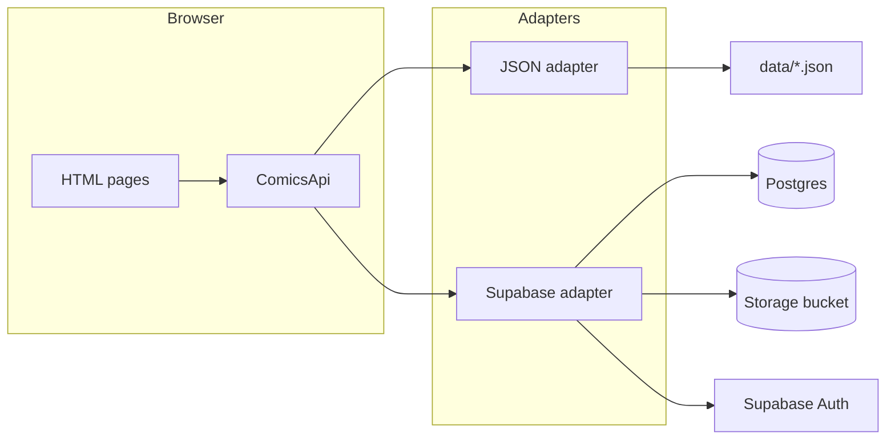

# FUNNY DAWG ONLINE

Static comic and art site with optional **Supabase** backend for accounts, uploads, and publishing.

## Tech stack

| Layer | Technology |
|-------|------------|
| Frontend | HTML, CSS, vanilla JavaScript |
| Themes | Separate CSS per theme (`css/themes/`) + `js/theme.js` |
| Data (dev default) | `data/comics.json`, `data/art.json` (legacy / seed only) |
| Data (production) | **Supabase** — Postgres, Auth, Storage |
| API | `ComicsApi` + adapters (`js/adapters/json-adapter.js`, `js/adapters/supabase-adapter.js`) |

## Architecture



- **Public pages** call `ComicsApi` (list comics, read volumes, art gallery).
- **`backend: "supabase"`** in `js/config.local.js` uses Postgres + Storage; comics and art are **not** read from JSON at runtime.
- **Upload / edit / my-work** require sign-in and Supabase.
- **Published** series, volumes, and art use `status = published`; drafts stay private.

### Main URLs

| URL | Purpose |
|-----|---------|
| `/comics/` | Published series list |
| `/comics/series-view/?series=SLUG` | Volumes in a series |
| `/comics/read/?series=SLUG&volume=SLUG` | Comic reader |
| `/art/` | Published art list |
| `/art/view.html?slug=SLUG` | Single art piece |
| `/upload/` | Upload art or comic volumes |
| `/edit/` | Edit + draft/publish toggles |
| `/my-work/` | Your comics and art |
| `/account/` | Sign in / account |

Layout demos (after DB seed): series **`layout-demos`** → four volumes (top-to-bottom, bottom-to-top, left-to-right, right-to-left). Old `/comics/layout-demos/.../` paths redirect to the reader URLs above.

## Setup

### 1. Local server

```bash
python -m http.server 8765
```

Open `http://localhost:8765/` (do not use `file://`).

### 2. Supabase config (gitignored)

```bash
cp js/config.example.js js/config.local.js
```

Edit `js/config.local.js` with your project URL and **anon** key, and set:

```javascript
backend: "supabase",
fallbackToJson: false,
```

See [supabase/README.md](supabase/README.md) for database and storage setup.

### 4. Production / GitHub Pages

`config.local.js` is not deployed (gitignored). For the live site:

```bash
cp js/config.production.example.js js/config.production.js
```

Edit `js/config.production.js` with the same URL and **anon** key as local. Commit `config.production.js` (the anon key is public by design), or gitignore it and generate it in your deploy workflow.

The site loads, in order: `config.js` → `config.production.js` → `config.local.js` (local only).

In Supabase **Authentication → URL configuration**, add your deployed origin (e.g. `https://YOUR_USER.github.io/funnydawgonline/`).

### 3. Import `comics.json` into Supabase (layout demos + Marrventure)

This copies everything from `data/comics.json` into Postgres as **published** rows (including **Layout demos** and test pages under `comic pages/test/`).

1. Run migrations `001`–`002` in Supabase SQL Editor.
2. **Sign up once** on the site (`/account/sign-up.html`) so a `profiles` row exists.
3. Run `003_seed_comics_from_json.sql`, then `004` and `005`.
4. Create Storage bucket **`comic-pages`** (public read).

Step 3 is safe to re-run (upserts by slug). Page images use `site:` paths from this repo until you replace them in Storage.

## Test instructions

### Prerequisites

- Migrations `001`–`005` applied  
- `config.local.js` configured  
- Local server running on port 8765  

### Visitor (logged out)

- [ ] **Comics** lists *Marrventure* and *Layout demos* (after seed).
- [ ] Open **Layout demos** → four volumes → each opens the reader with test images.
- [ ] **Art** shows only **published** pieces; drafts hidden.

### Creator (logged in)

- [ ] Sign up / log in / sign out.
- [ ] **Upload** → comic volume → redirects to **edit**; **Upload pages** only (no publish on upload page).
- [ ] Publish sliders on edit → **Go to comic** opens reader.
- [ ] Upload art → edit → publish → **Go to art**.
- [ ] **My work** lists your pieces with **Edit** links.

### Console

On comics, art, upload, and edit: no red errors in the browser console (F12).

## Docs

- [docs/BACKEND.md](docs/BACKEND.md) — API and file map  
- [supabase/README.md](supabase/README.md) — SQL migrations and bucket policies  

## Secrets

Never commit `js/config.local.js`. Never put the Supabase **service role** key in the frontend.
